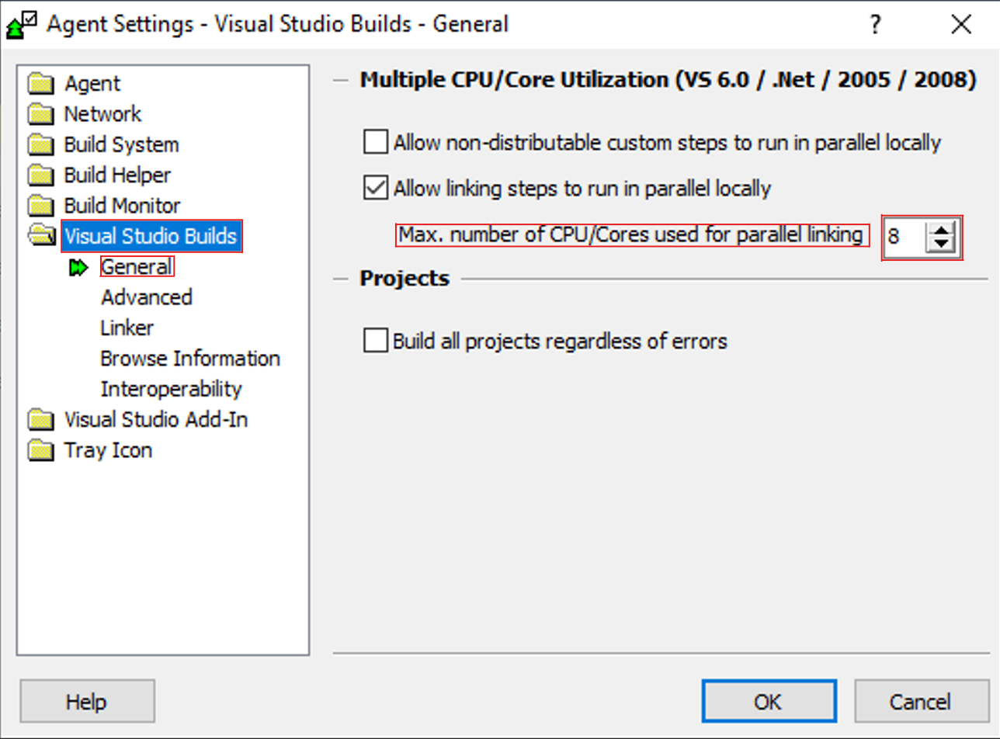

# Known Issues

## Building Executable

### Network related errors in Visual Studio

- If you get Network releated issues inside Visual Stuido try this.

1. Download the [Network Fix](GTA%20V%20-%20Source%20Code%20Patches/network%20fix%20(optional)).

2. Find out your IPv4 Address:
   - **In Windows 11**: 
     Settings → Network & Internet → Advanced Network Settings. Select the Network Adapter you're using and press **View Additional Properties**.  
     Note down your IPv4 Address.

   - **In Windows 10**:  
     Navigate to Settings → Network & Internet → Change Adapter Options. Select the Network Adapter you're using, right-click it, and press **Details**.  
     Note down your IPv4 Address.

3. Replace `PUT-IP-HERE` with your IPv4 Address in `studios.meta` and `rag.meta`
4. Move `studios.meta` and `rag.meta` to `X:\gta5\tools_ng\etc\globals`

---

### Error when compiling Active Solution Configuration Final

```
error C2065: 'overrideScriptRpfName': undeclared identifier
error C2065: 'overrideDIcScriptRpfName': undeclared identifier
error LNK1181: cannot open input file x:\gta5\src\dev_ng\objects\game3_lib_2012_unity\x64_Final\v110_xp\game3_lib.lib'
```
Solution: grab a new `X:\gta5\src\dev_ng\game\scene\FileLoader.cpp` from `GTAVSP.7z` and replace with current one.
  - Note that if a file gets a error while compiling do the same and grab one from `GTAVSP.7z` and replace it with the current one, but is not guaranteed that it may fixed the error.
---

## Building Shaders:

### Fatal Error: Unable to create default effect 'common:/shaders/im', cannot continue.
If u didn't put the shaders to the game directory or you dont have the low quality shaders, then this error may appear.<br>
Just try these solutions in order to make the game work:

##### Solution 1: 
Just Simply Compile the low quality shaders by [following these steps](#building-shaders).

##### Solution 2:
Just make your shaders quality "High" and dont lower that.<br>
To do this, Follow this steps:

1. Go To **\Documents\Rockstar Games\GTA V**
2. Open *settings.xml*
3. Change  `<ShaderQuality value="0" />` To `<ShaderQuality value="1" />`
4. Save the file and Done!
---
### Virtual machine or computer lagging or freezing while building shaders.

- If your VM or Computer start lagging, freezing or crashing when trying to build try this:
  - Open `Incredibuild Agent Settings`
  - Under `Visual Studio Builds` / `General` lower the `Max. number of CPU/Cores used for parallel linking`

<div style="text-align:center;">

</div>

---

## Building Scripts

### RagScriptEditor crashing while at building cache.
- Try running `X:\gta5\src\dev_ng\All_In_One_Install_Environment_Variables.bat` and `X:\gta5\src\dev_ng\setenv.bat` again.
- Change your Windows Language to `English (United States)`

---

## Other Issues

### Executable not booting with an cracked game.

Solution:
1. Go to [`GTA V - PC Build Required Files/GTA V - Cracked Game Patch`](GTA%20V%20-%20PC%20Build%20Required%20Files/GTA%20V%20-%20Cracked%20Game%20Patch) folder  
2. Copy everything inside of it to your game folder.
  - This is because the cracks replace the original dll files with edited ones that the compiled executable does not support.
---

### Fixing DLL loading issues for tools

If a tool reports that a DLL file is missing, cannot be loaded, or any other dll related error, the DLL may simply be blocked by the Windows 11 zone information preservation feature.

To fix it for one specific file:

1. Navigate to the location of the DLL file.
2. Right-click the DLL file and select **Properties**.
3. In the **General** tab, look for the **Security** section at the bottom.
4. If you see an **Unblock** checkbox, check it.
5. Click **Apply**, then **OK**.
6. Try using the tool again.

Disbale the feature on all files from the X drive **(Recommended)**:

1. Open PowerShell as Administrator and run :
```
Get-ChildItem "PATH TO YOUR gta5 FOLDER" -Recurse | Unblock-File   
```

You have to use the path to your `gta5` folder. It cannot include the virtual X: drive you need to use the path to the folder on your actual hard drive.

In many cases, this resolves DLL loading errors caused by the Windows 11 zone information preservation feature.

---

## PS4 Patch Builder

### Building pkg files Error file could not be opened/written to.
Error file could not be opened/written to.
 - When this appears you don't have enough space or, The file is corrupt, please extract the file again.

---

## Issues inside the PS4 build

### Broken Render Distance - This is due to some errors in the render distance code but if you are a decent coder, you could fix it.

---
