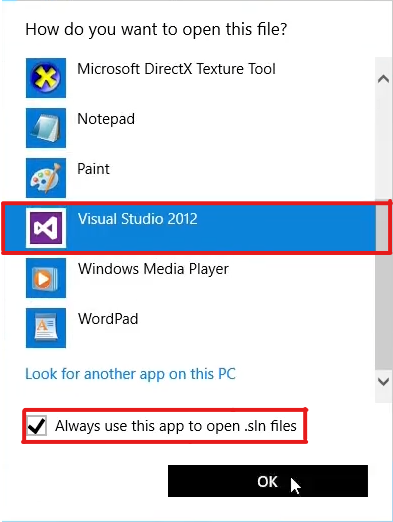
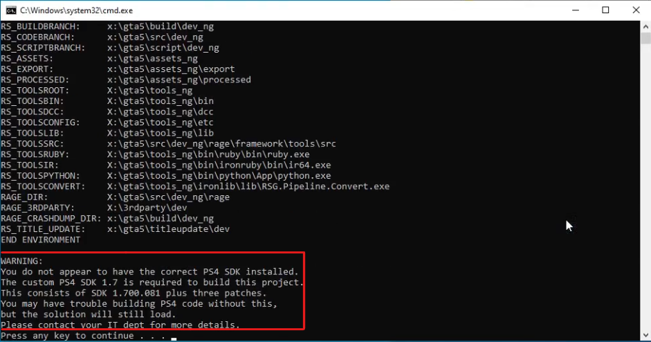
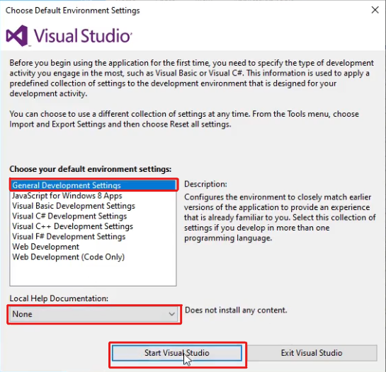
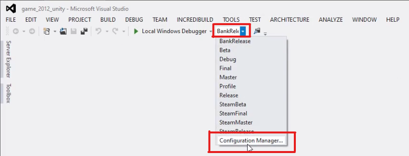
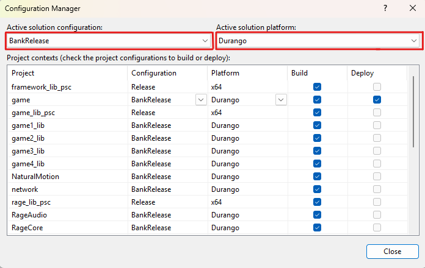
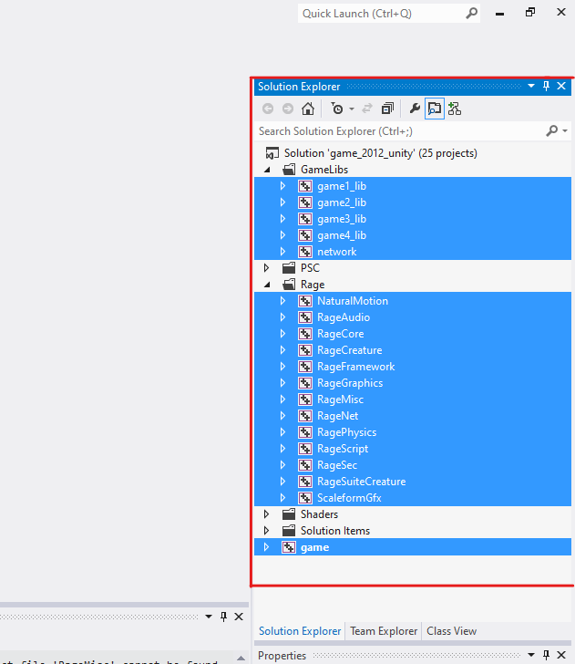
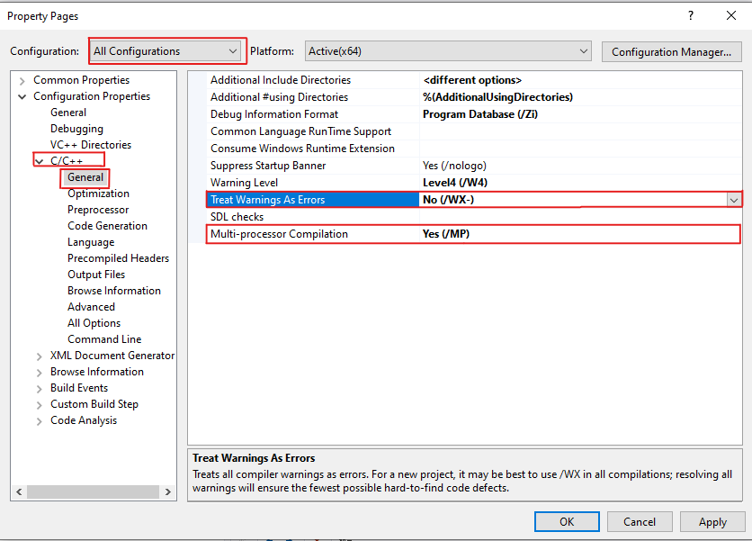
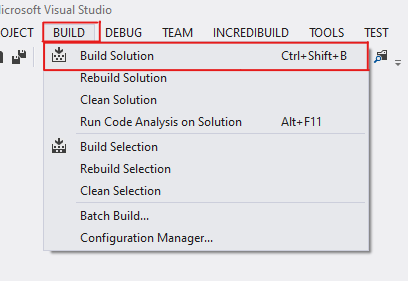

# Grand Theft Auto V: Source Code Build Guide *For Xbox One*

$\color{red}{\text{This build compiles without any errors but it has not been tested.}}$   

<details>
<summary><strong>Table of Contents</strong></summary>

* [Requirements](#requirements)
* [Installing the Toolset](#installing-the-toolset)
* [Creating X:\ Drive](#creating-x-drive)
* [Setting up the Xbox One SDK](#setting-up-the-xbox-one-sdk)
* [Patching Source Code and Tools](#patching-source-code-and-tools)
* [Building Executable](#building-executable)
* [Building Shaders](#building-shaders)
  * [How to Build Low Quality Shaders](#how-to-build-low-quality-shaders-optional)
* [Building Game Scripts](#building-game-scripts)

</details>

## Requirements:
- Use separate, fresh copies of the source code for PC, PC Retail Patches, Xbox One, and PS4, as the patches may conflict with one another.
- Grand Theft Auto V for Xbox One
- GTAVSP.7z - Source Code  
   - SHA1 Hash: `ca39323730ed644fa534a2946506d4287f92a799`
   - Password: `Mi76#b>9mRed`
- [7-Zip](https://www.7-zip.org/)
- [GTA V Source Code Toolset](https://pixeldrain.com/u/2XdabBq3)
- [Xbox One SDK](https://pixeldra.in/u/FZwfA7Xv)
- Also an Xbox One Devkit for running the build.

## Installing the Toolset

**You should deactivate your Anti-virus protection before doing any of the next steps.**

1. Run `Install_Toolset.bat`

#### Visual Studio 2012

   - At `Optional features to install`: only select `Microsoft Foundation Classes for C++`

#### IncrediBuild

   - At `Welcome` select `Install IncrediBuild`
   - At `Component Selection` select IncrediBuild Agent and IncrediBuild Coordinator
   - Do not change any other settings

#### .Net Framework 3.5

   - If the installer freezes:
     - Go to `Installation_Files\3. .Net Framework 3.5 Installer\Source Files`
     - Copy `setup.bat` to `3. .Net Framework 3.5 Installer` and run it as administrator

#### DirectX SDK (June 2010)

   - If you get `error S1023`:
     - Uninstall Visual C++ 2010 Redistributable
     - Reinstall DirectX SDK (June 2010)
   - At `Help Improve the DirectX SDK` select `No, I would not like to participate`

#### Helix-Core-Server (optional only required for some tools)

   - Don't change the port
   - For path, just select any empty folder
   
## Creating X:\ Drive

1. Create a new folder anywhere you want  
2. Inside the folder, create a folder called `gta5`  
3. Copy all content from `GTAVSP.7z/GTAV Source` folder to `gta5`  
4. Copy the two `.bat` files from the [`GTA V - X Drive Batch files`](GTA%20V%20-%20X%20Drive%20Batch%20Files) folder to your new folder  
5. Run `Connect_X_Drive.bat`  
6. Right-click on the gta5 folder, turn off the "Read-Only" option, then press "Apply"

## Setting up the Xbox One SDK

1. Get [`Xbox One XDK - Sorynx.7z`](WIP)
2. Run `XDK.exe` and follow the instructions you dont need to change any settings.
3. Get [`ADK dll fix.7z`](GTA%20V%20-%20Xbox%20One%20Build%20Required%20Files/GTA%20V%20-%20Xbox%20One%20ADK%20dll%20fix/ADK%20dll%20fix.7z).
4. Paste the `adk` folder to `C:\Program Files (x86)\Microsoft Durango XDK\`.
5. Run [`XBOX ONE SDK ENV Installer.bat`](GTA%20V%20-%20Xbox%20One%20Build%20Required%20Files/GTA%20V%20-%20Xbox%20One%20SDK%20Env%20Setup/XBOX%20ONE%20SDK%20ENV%20Installer.bat)

## Patching Source Code and Tools

1. Copy this [`main.cpp`](GTA%20V%20-%20Source%20Code%20Patches/Xbox%20One/main.cpp/main.cpp) file to `x:\gta5\src\dev_ng\rage\base\src\system` and overwrite the existing file.
   - Remember to add any aditional boot arguments you want to use to the file at line 1283 before compiling for example the [comments for RAG](WIP)
2. Copy all folders from [`dll_patches_x.zip`](GTA%20V%20-%20Source%20Code%20Patches/tools%20patch) to `X:\gta5\tools_ng\bin`, making sure to overwrite any existing files.
3. Get [`GTA V - Source Code Patches/Xbox One/forceinclude/any_types.h`](GTA%20V%20-%20Source%20Code%20Patches/Xbox%20One/forceinclude/any_types.h) and put the file in `X:\gta5\src\dev_ng\rage\base\src\forceinclude\templates`.
4. Put [`All_In_One_Install_Environment_Variables.bat`](GTA%20V%20-%20Source%20Code%20Patches/Xbox%20One/All_In_One_Install_Environment_Variables.bat) inside `X:\gta5\src\dev_ng\`.
5. Run `X:\gta5\src\dev_ng\All_In_One_Install_Environment_Variables.bat`  
6. Run `X:\gta5\src\dev_ng\setenv.bat`.
7. Run `X:\gta5\src\dev_ng\rage\base\src\forceinclude\templates\makeheaders.bat`.

## Building Executable

Check out [known issues for building the executable](Known-Issues.md#building-executable)

1. Run `X:\gta5\src\dev_ng\game\VS_Project\load_sln_unity_2012.bat`

<div style="text-align:center;">

</div>

- A warning will show in the Command Prompt Window stating you are missing an SDK, please ignore it and press any key to continue and open it with Visual Studio 2012.

<div style="text-align:center;">

</div>

- If you are promoted with `Choose Default Environment Settings` Select `General Development Settings` and at `Local Help Documentation` select `None`.

<div style="text-align:center;">

</div>

2. Once the solution loads, open the drop down menu that says `Debug` at the top, select `Configuration Manager`.

<div style="text-align:center;">

</div>

3. Change `Active Solution Platform` to `Durango` and `Active Solution Configuration` to `BankRelease` then close the configuration window.
  - You can change `Active Solution Configuration` to anything you want all will compile but this guide focuses on running the `BankRelease`.

<div style="text-align:center;">

</div>

4. Hold Ctrl key and select all projects under `GameLibs`, `Rage` and `game` folder, right-click and select `Properties`.
  - Every time you change `Active Solution Configuration` you will need to repeat this step or your builds will fail.
<div style="text-align:center;">

</div>

5. In the „Configuration” drop down, select „All Configurations”.
   - Select `C/C++ >General”, and set „Treat Warnings as Errors` to `No (/WX-)`.
   - For faster compiles set `Multiprocessor Compilation` to `Yes (/MP)`.
   - Then click `Apply` and `OK`.
   - If you get the error `C1060: Compiler is out of heap space` during build, turn off `Multiprocessor Compilation`.

<div style="text-align:center;">

</div>

6. At the top of the window, select `Build > Build Solution` and wait for build to finish.

<div style="text-align:center;">

</div>

7. Output folder is: `X:\gta5\titleupdate\` there you will find your compiled executable move it to your game directory.

## Building Shaders

Check out [known issues for building shaders](Known-Issues.md#building-shaders)

Optional: For multicore compilation, go to `X:\gta5\tools_ng\etc\RageShaderManager` and, in all .xml files, change every instance of `SingleCore=` to `"false"`.

1. Run `X:\gta5\src\dev_ng\game\VS_Project\load_sln_unity_2012.bat`
2. Under `Shaders`, right click the `shaders_rc` project and click `Build`
---
#### How to Build low quality shaders (optional)
1. Right click the `shaders_rc` project and click `Properties`
2. Select `Configuration Properties > NMake`
3. Under `General`, change all command lines from ending with `win32_40.bat` to ending with `win32_40_lq.bat`, then click `Apply` and `OK`
4. Rebuild shaders and wait for it to finish
---
To see the progress and watch its status, in the taskbar, open the Overflow Menu (the small ^ in the taskbar on the right).
Find `IncrediBuild Agent` (the one with a green arrow), right-click it, and press `Build Monitor`.
In `Build Monitor`, on the left press the icon at the top that should say `Progress`.
You should now see what you're building, and at the bottom left of the window, you'll see a percentage of how complete it is out of 100%.

3. Copy `X:\gta5\titleupdate\dev_ng\common` to the game directory.
---
## Building Game Scripts

Check out [known issues for building scripts](Known-Issues.md#building-scripts)

#### If your Incredibuild trail is over use [this](Extras/Incredibuild%20Crack/ReadMe.md).
1. Open Command Prompt and Run the following commands:
```batch
X:
cd X:\gta5\src\dev_ng
setenv
cd ..\..\tools_ng\bin\RageScriptEditor
ragScriptEditor
```
2. In the editor, select File > Open Project and open `X:\gta5\script\dev_ng\singleplayer\GTA5_SP.scproj`
   - Optinaly you can also compile them as Debug.
3. Select `Compiling > Intellibuild > Build Project` and wait until the compiling process finishes 
   - This will take multiple hours, especially in a virtual machine.

## Currently we dont have a guide on how to install, run or how to connect this build to the RAG.
